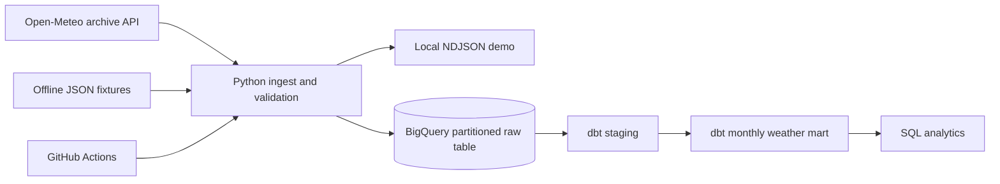

# Cloud Data Warehouse & Analytics

**Python 3.10+ · BigQuery · dbt · Docker · GitHub Actions**

Portfolio-grade **weather data ELT demo**: [Open-Meteo Historical Weather API](https://open-meteo.com/en/docs/historical-weather-api) → **Python** → **Google BigQuery** → **dbt** → analytics. Three cities: Kyiv, London, New York.

> Independent demonstration project, not a client project. Local fixture mode runs without GCP credentials. Fixture values are illustrative, not actual historical observations. BigQuery/dbt deployment requires a GCP project and has not been run here.

## Architecture



## Highlights

- Public API ingestion with UTC daily metrics, request timeout, schema and range validation.
- **Idempotent** BigQuery `MERGE` keyed on `(city, observation_date)`; temp staging table cleaned up after load.
- BigQuery daily table partitioned by date and clustered by city.
- dbt staging and monthly reporting model with source, schema, and custom SQL tests.
- Offline fixture mode, pytest, Ruff and GitHub Actions CI.
- Dockerized local demo.

## Quick start (no GCP account)

```bash
python3 -m venv .venv
source .venv/bin/activate
pip install -e '.[dev]'
pytest -q
python -m cloud_warehouse --source fixture --sink local
cat output/weather_daily.ndjson
```

Or run the offline demo via Docker:

```bash
docker compose up --build
```

## Download **real** public weather observations locally

```bash
python -m cloud_warehouse --source api --sink local --start 2024-01-01 --end 2024-01-31
```

The historical endpoint may have upstream data latency or temporary rate limits. Dates must end before today.

## BigQuery setup (optional; may incur charges)

1. Create a GCP project, enable **BigQuery API**, configure billing as required, and authenticate locally using `gcloud auth application-default login`. Your account needs permission to create datasets/tables, load data, and run BigQuery jobs.
2. Choose a dataset in a compatible region (default BigQuery location may depend on account settings). If using `US` in dbt profile, ensure the dataset is in `US` too.
3. Run:

```bash
export GCP_PROJECT_ID='your-project-id'
export BQ_DATASET='weather_analytics'
python -m cloud_warehouse --source api --sink bigquery --start 2024-01-01 --end 2024-01-31
```

4. Install dbt (`pip install dbt-bigquery`), copy `dbt/profiles.yml.example` to `dbt/profiles.yml`, replace project ID, then:

```bash
cd dbt
dbt debug --profiles-dir .
dbt build --profiles-dir .
```

5. Example query:

```sql
SELECT city, month, observed_days, avg_daily_max_temp_c, precipitation_total_mm
FROM `your-project-id.weather_analytics.mart_city_monthly`
ORDER BY month, city;
```

**Caveats:** This is a batch demonstration, not a fully managed production system. Full backfills, quota limits, schedule, alerting, infrastructure-as-code, and secret management are follow-up improvements. BigQuery load behavior should be verified in your own cloud environment before publishing deployment claims. Dataset name in `dbt/models/staging/sources.yml` should match `BQ_DATASET` if changed.

## Structure

```text
src/cloud_warehouse/  ingestion, validation, BigQuery MERGE
fixtures/             reproducible offline weather samples
dbt/models/           source, staging and analytics mart
dbt/tests/            custom data-quality checks
tests/                Python unit tests
.github/workflows/     continuous integration
docs/                 Upwork portfolio description
```

## License and attribution

Weather source: [Open-Meteo](https://open-meteo.com/) (review their applicable licensing and API usage terms). Sample fixture values were created for this demo. No credentials or customer data are included.
